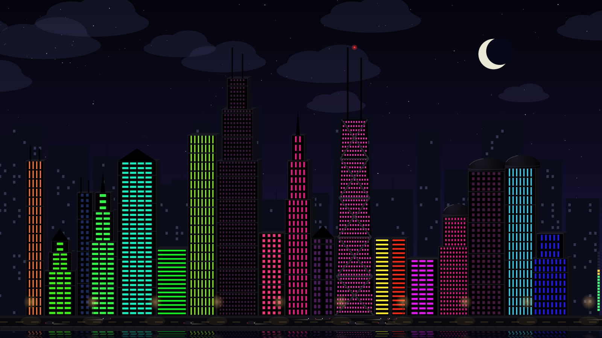
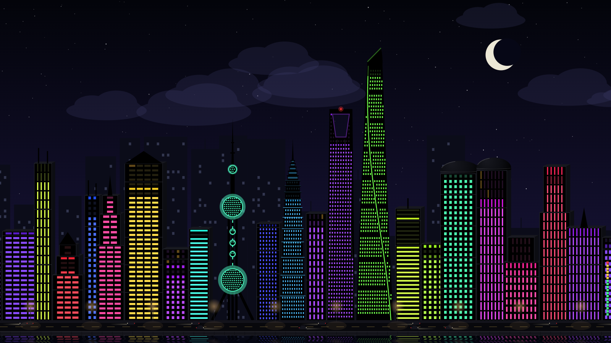
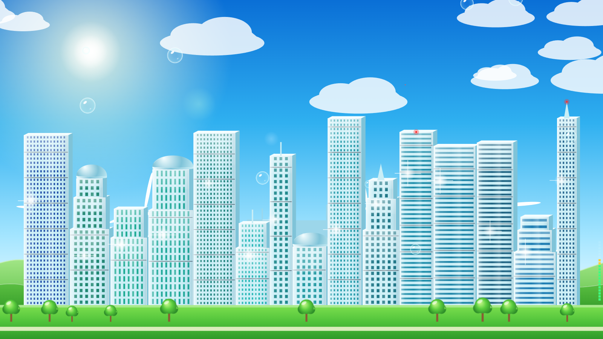

# City Pulse

A night-time city skyline whose windows pulse to your music. Run it as a small always-on-top widget in the corner of your desktop, or full screen on a TV while you have people over.


| Cyberpunk | Synthwave |
| --- | --- |
|  |  |

**Beat flash:** buildings light up on their part of the beat and go dark in between.



| Shanghai: Floors with random colors, during a loud song | Dark City in the rain: one solid color |
| --- | --- |
|  |  |

**Pan view:** the city keeps going past the screen edges. Drag or scroll to choose your part of it.

| Abyssal City | Aero |
| --- | --- |
|  |  |

## Features

- **Listens to whatever your PC is playing.** On Windows, system audio is picked up automatically. On a Mac, see [Mac](#mac-preview).
  - The song is split into 8 bands, from bass to treble (Bass, Kick, Low-mid, Mid, Upper-mid, Presence, Treble, Air).
  - Each building is assigned one band for good. Landmarks are spread from bass to treble, so each famous building owns a clear part of the song.
  - Buildings on the same band move together.
- **Listen to anything (Windows):** choose any output (speakers, headphones, TV) or input (microphone, line-in). City Pulse listens to that device directly, so you never have to change your Windows default. "Default output" follows whatever Windows is playing through.
- **Calm when quiet:** with no music playing, the city sits still.
- **Loudness meter:** on Windows, tops out at your Windows volume, so at 50% volume it peaks halfway.
- **Skylines:**
  - **14 real cities** with hand-drawn landmarks: Charlotte, Chicago, Dubai, Hong Kong, London, New York, Paris, San Francisco, Seattle, Shanghai, Sydney, Tampa, Tokyo and Toronto. New York is the first one you see.
  - **14 themed cities**: Abyssal City, Aero, Atlantis, Aurora Harbor, Brasshaven, Cyberpunk, Dark City, Desert Mirage, The Grid, Lantern District, Lunar Colony, Neon City, Neon Strip and Synthwave. Each has its own sky, ground, creatures or machines, and something unique that moves with the music.
- **Light styles:**
  - **Floors:** an equalizer that climbs each building, with a falling peak marker.
  - **Pulse:** each building's windows follow the volume.
  - **Beat flash:** a building lights up on a hit, then fades.
  - **Fill by loudness:** buildings rise with how loud the song really is, so a quiet song gives a low city and a loud chorus a tall one.
  - **City line:** one flat height for the whole city. Buildings light up to the same real height and the peaks line up level. Drag the dotted line on screen, or use the slider in Settings.
  - A **Reactivity** slider runs from calm (smooth swells, for background viewing) to wild (instant and punchy, for parties). Every building keeps reacting at any setting.
- **Color effects:** Spectrum, Wave, Fade, Solid, Breathing, Random and Smooth random, plus a brightness slider. Solid and Breathing use **Pick color**, which keeps your last 8 colors as swatches.
- **Scene:**
  - a street with traffic, a park, or a thin river with reflections
  - a hazy back skyline and 3D building detail
- **Weather:** rain, snow, thunderstorms (lightning on the bass), fog, cherry blossoms and autumn leaves.
- **Live weather (optional):** mirror the real current weather of the skyline's city, or of any city you type, refreshed every 15 minutes from [Open-Meteo](https://open-meteo.com) (free, no account). City Pulse never looks up where you are: only the name you search for, and then that place's rounded coordinates, are sent. It's always night in City Pulse, so a sunny day shows as a clear night.
- **Ambient motion:** each item can be switched on or off: blinking roof lights, windows switching on and off, searchlights, stars, shooting stars, moon, clouds, planes and flying cars.
- **Views:**
  - **Fit:** the whole city on one screen. In the widget it shows whole buildings only; on full screen and the wallpaper the skyline runs off the edges.
  - **Pan:** drag or scroll to choose your part of the city, or use the **Position** slider (handy for the wallpaper, which can't be dragged).
  - **Scroll:** the city you picked scrolls past endlessly.
  - **Tour:** slowly scrolls through every city, real and themed, with name captions. Made for a TV. Choose the speed, the direction (right to left or left to right) and which cities it visits.
- **Presets:** four built in (Lounge, Chill Night, Party, Neon Tour). Your own presets are shared between the widget and full screen.
- **TV-friendly:**
  - full screen opens on whichever display the widget is on
  - **multiple screens:** full screen and the live wallpaper can each run on all screens, with either **its own city on each screen** or **one tour across all of them**. In the tour, cities scroll from screen to screen, each screen shows its own city name, and each screen can have **its own lights** (colors, style, brightness): in the Control Center, choose **Customize → Full screen** (or Wallpaper) and pick the screen.
  - the controls auto-hide
  - optional burn-in protection creeps the picture a few pixels over about 20 minutes
- **Control Center:** the one window for everything, in three steps: **1. Listen to** (the audio source), **2. Where the city shows** (widget, full screen, wallpaper, and a **Tour across every screen** button), **3. Customize**: pick Widget, Full screen or Wallpaper, then the screen if you have several, and its settings appear right below. Click the tray icon, the ☰ button, or launch City Pulse again to open it.
- **Lives in the tray:** no taskbar button. The tray icon by the clock shows or hides the widget, and also has full screen, Settings, Start with Windows and Quit.
- **Live wallpaper (experimental):** puts City Pulse behind your desktop icons on the display you choose, with its own look (Control Center → Customize → Wallpaper). It relies on an unofficial Windows feature, so a future Windows update could break it. If that happens, it switches itself off.

## Install (Windows)

Download `City-Pulse-Setup-x.y.z.exe` from Releases and run it. It adds Start-menu and desktop shortcuts.

The exe isn't code-signed yet, so Windows SmartScreen may warn on first run. Choose **More info → Run anyway**.

### Mac (preview)

The Mac version is new and not signed by Apple yet.

1. From Releases, download `City-Pulse-x.y.z-arm64.dmg` for Apple Silicon (M1 and later) or `City-Pulse-x.y.z-x64.dmg` for Intel Macs.
2. Open it and drag **City Pulse** into **Applications**.
3. The first time, macOS blocks it. Open **System Settings → Privacy & Security**, scroll down and choose **Open Anyway**. If macOS says the app "is damaged", run this in Terminal, then open it again:

```bash
xattr -cr "/Applications/City Pulse.app"
```

4. Allow microphone access when asked. City Pulse lives in the menu bar, not the Dock.

**Listening on a Mac:** macOS doesn't let apps hear what's playing, so City Pulse listens to an input you pick under **Listen to**: a microphone, a line-in, or [BlackHole](https://existential.audio/blackhole/), a free driver that carries your Mac's sound:
1. Install **BlackHole 2ch**.
2. In **Audio MIDI Setup**, click **+ → Create Multi-Output Device** and tick your speakers or headphones and **BlackHole 2ch**.
3. Choose that Multi-Output Device as your sound output, then choose **BlackHole 2ch** under **Listen to**.

Mac differences: updates are downloaded by hand (the menu's **Check for updates…** opens the Releases page), the loudness meter isn't scaled by the Mac volume, and to uninstall you drag the app to the Bin.

### Updates

On Windows, City Pulse updates itself, so you never need to download a new installer.
- It checks for a new version when it starts and every 6 hours.
- A new version downloads in the background and installs the next time City Pulse restarts. To install it straight away, use the tray's **Restart to update**.
- There's only ever one copy installed. Running a newer installer by hand also replaces the old version and keeps your settings and presets.

### Uninstall

Use the tray's **Uninstall City Pulse…**, or go to Windows **Settings → Apps → Installed apps → City Pulse → Uninstall**. Either one removes:
- the app
- its settings and presets
- its Start with Windows entry

## Use

- The widget opens in the bottom-right corner. Hover over it to show the toolbar, drag the toolbar to move the widget, and drag the edges to resize it. **✕** tucks it into the tray.
- **⛶ Full screen** opens the big view on the widget's display: drag the widget to your TV first. **Esc** closes full screen. When it covers all screens, Esc closes every screen at once, whichever window has focus.
- **⚙ Settings** opens the Control Center at the widget’s settings: presets plus the Skyline, Lights, Scene, Weather and Ambient sections. Changes apply to the widget live. In full screen, ⚙ opens the panel on screen instead.
- **Right-click the tray icon** for full screen, settings for the widget, full screen and wallpaper (each opens the Control Center there), Live wallpaper, Start with Windows, Check for updates, Uninstall and Quit.
- Keyboard shortcuts:

| Key | Action |
| --- | --- |
| F | Full screen |
| M | Light style |
| C | Color effect |
| V | View |
| W | Weather |

## Run from source

Requires [Node.js](https://nodejs.org/) 18+.

```bash
npm install
npm start
```

If the app doesn't start after `npm install`, Electron's download step was probably blocked. Newer npm versions skip install scripts by default. Run it yourself:

```bash
node node_modules/electron/install.js
```

You can also open `index.html` straight in a browser for the full-screen version. Use **🔊 Share audio** and tick "Share audio" in the picker. The browser version has no tray, output menu or wallpaper; those need the app.

`npm test` checks the page-access gate and lays out every city in every view at a few window sizes, in a hidden, muted window.

## Build the exe

```bash
npm run dist
```

The installer is written to `dist/`.

On a Mac, `npm run dist:mac` builds the `.dmg` files. Without a Mac, GitHub builds them: run **Mac build** from the repository's **Actions** tab and download the result from the run's page.

## Publish a new version (maintainers)

1. Bump `"version"` in `package.json`, for example from 0.6.1 to 0.6.2, then commit and push.
2. Create the release, which also makes its tag. Doing this first matters: if the release script has to create it, it can end up making two.

```bash
gh release create v0.6.2 --title "City Pulse 0.6.2" --generate-notes
```

3. Within two hours, run the release script with a GitHub token. It uploads into that release:

```bash
GH_TOKEN=$(gh auth token) npm run release
```

This builds the installer and adds it to the release, together with `latest.yml`, the file installed copies check to find updates. Every installed Windows copy then updates itself. Creating the release also starts the **Mac build**, which adds the two `.dmg` files to it a few minutes later.

Automatic updates need the repository to be **public**, because installed copies read the Releases page without signing in.

## Notes

City skylines and landmarks are simplified illustrations. The project isn't affiliated with any city, building owner or brand.

## License

[MIT](LICENSE)
